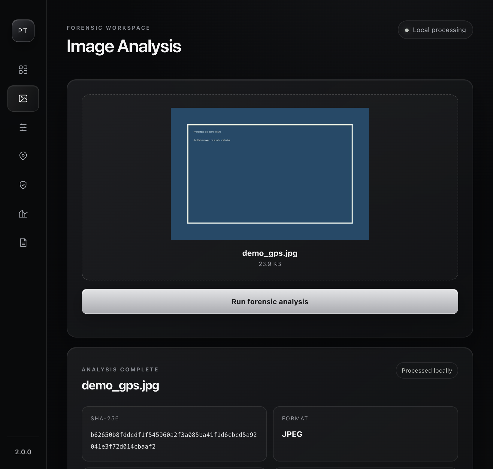
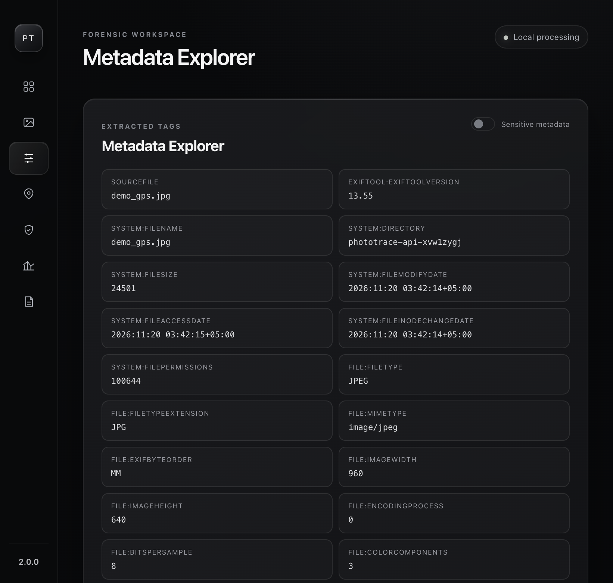
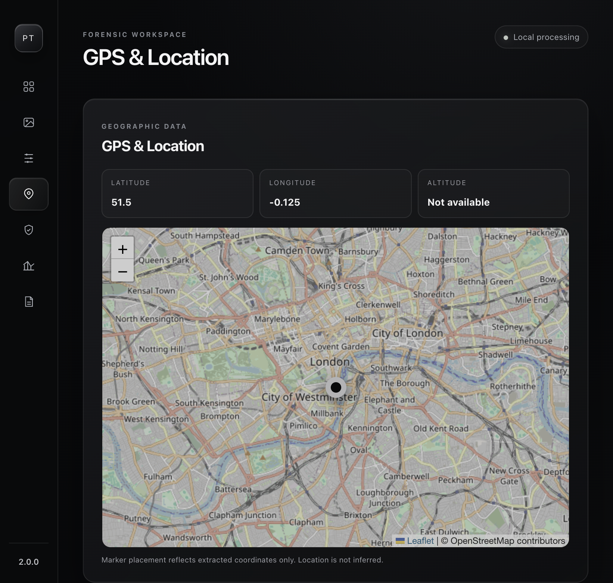
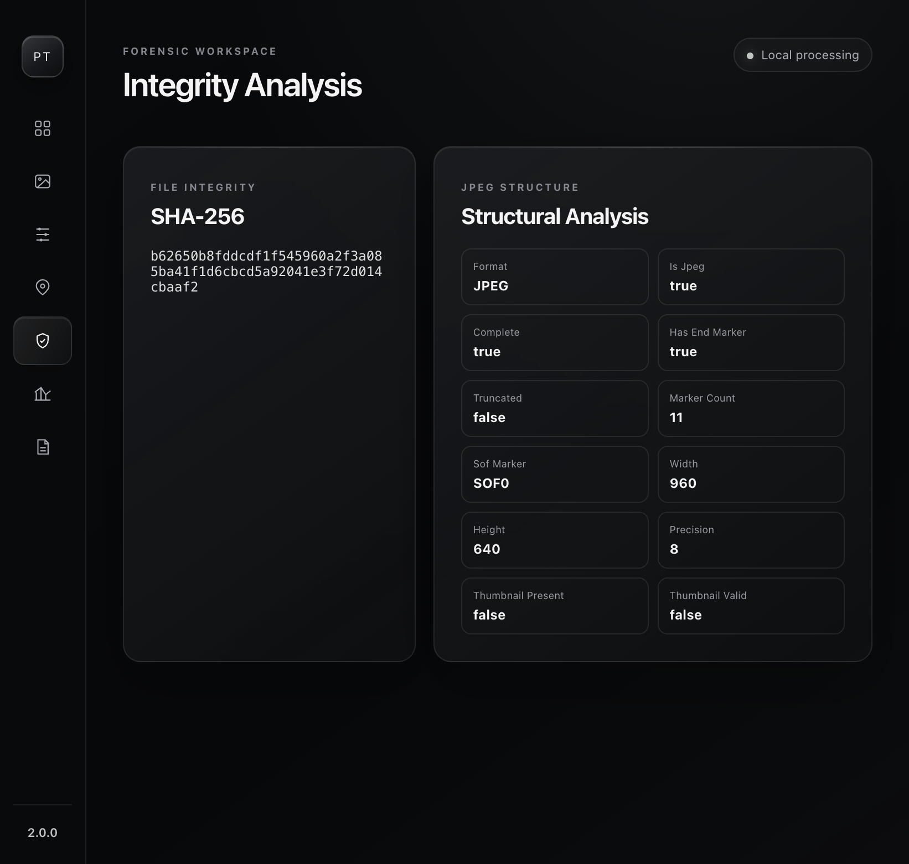
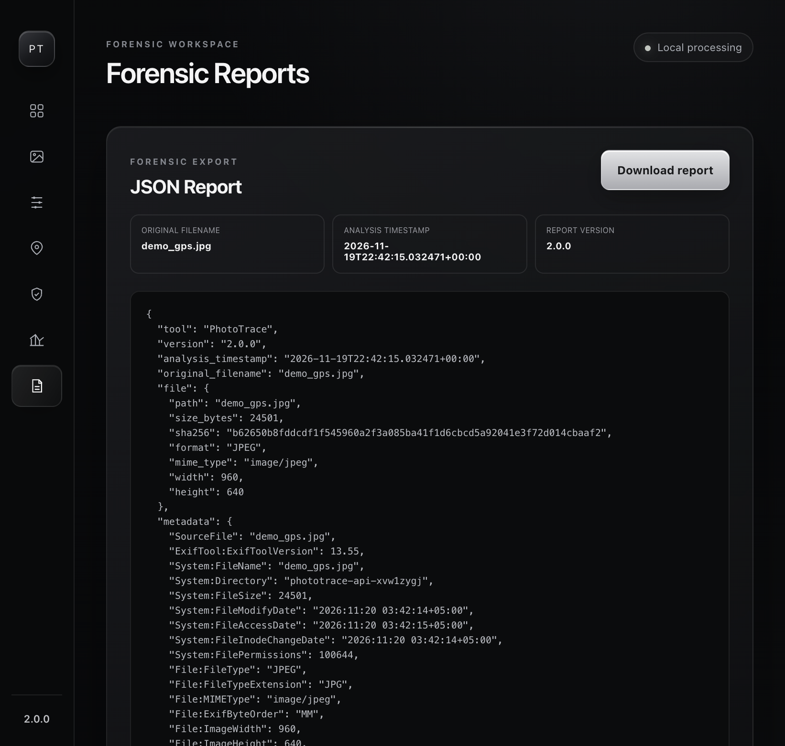

# PhotoTrace 2.0

PhotoTrace is a local-first image forensics workspace for inspecting the
metadata and file structure behind an image. It is intended for education,
demonstrations, engineering portfolios, and preliminary evidence review — not
for making independent authenticity or fraud determinations.

The application keeps uploaded files in temporary local storage, analyzes them
with a FastAPI/Python backend, and presents the results in a React/TypeScript
web interface. No image is sent to an external analysis service by PhotoTrace.

## What it does

PhotoTrace helps an investigator or developer:

- inspect available EXIF, XMP, file, camera, lens, date, and software metadata;
- validate and convert GPS coordinates extracted from metadata;
- view valid coordinates on a Leaflet map;
- calculate a SHA-256 hash for the analyzed file;
- inspect JPEG markers, dimensions, quantization tables, EXIF/XMP indicators, and
  embedded-thumbnail signatures;
- build a metadata timeline and report timestamp conflicts;
- compare metadata dimensions and software fields for consistency indicators;
- generate, display, and download a structured JSON forensic report; and
- use either the web interface or the command-line entry point.

Findings are conservative, explainable indicators. They require context and do
not establish that an image was edited, authentic, or fraudulent.

## Technology stack

- **Backend:** Python, FastAPI, Uvicorn, Pillow, ExifTool
- **Frontend:** React 19, TypeScript, Vite
- **Mapping:** Leaflet and React-Leaflet with OpenStreetMap tiles
- **Testing:** Python `unittest`, FastAPI `TestClient`, TypeScript/Vite build,
  and Oxlint

ExifTool is an external system dependency and must be installed separately from
the Python packages in `requirements.txt`.

## Architecture

```text
frontend/          React + TypeScript UI and Leaflet map
backend/main.py    FastAPI routes, CORS, temporary upload handling
phototrace_app/    Validation, extraction, analysis, and report modules
phototrace.py      Local command-line entry point
tests/             API, validation, parser, timeline, and report tests
reports/            Local report outputs and protected project fixtures
```

The workflow is:

1. The frontend sends an image as multipart form data.
2. FastAPI writes it to a temporary directory and enforces the 50 MB limit.
3. Validation checks the extension, size, and readable raster content where
   applicable.
4. ExifTool extracts grouped metadata as JSON.
5. The analysis modules derive GPS state, integrity findings, JPEG structure,
   timeline events, and advanced consistency indicators.
6. The report builder adds file facts, a SHA-256 hash, sanitized metadata paths,
   findings, and method limitations.
7. The API returns the report or streams a safe JSON download filename.

## Local installation

### Prerequisites

- Python 3.14 or another Python version compatible with the installed
  dependencies
- Node.js and npm
- ExifTool available on `PATH`

Install ExifTool using the package manager for your operating system, then
verify it:

```bash
exiftool -ver
```

### Backend setup

From the project root:

```bash
python3 -m venv .venv
source .venv/bin/activate
python -m pip install -r requirements.txt
```

### Frontend setup

```bash
npm --prefix frontend install
```

## Running PhotoTrace

### Web application

Start the local API:

```bash
.venv/bin/python -m uvicorn backend.main:app --reload \
  --host 127.0.0.1 --port 8000
```

For frontend development, use a second terminal:

```bash
npm --prefix frontend run dev
```

Open `http://localhost:5173`. The Vite proxy forwards `/api` requests to the
local FastAPI server at `http://localhost:8000`.

To serve a production frontend build through FastAPI:

```bash
npm --prefix frontend run build
.venv/bin/python -m uvicorn backend.main:app \
  --host 127.0.0.1 --port 8000
```

Then open `http://127.0.0.1:8000`.

### Command line

```bash
.venv/bin/python phototrace.py /path/to/image.jpg
.venv/bin/python phototrace.py /path/to/image.jpg --reports-dir reports
```

The CLI saves a non-overwriting JSON report in `reports/` by default.

## Web interface sections

The sidebar provides:

- **Dashboard** — analysis status and module overview
- **Image Analysis** — upload, preview, validation, and analysis
- **Metadata Explorer** — extracted tags with sensitive fields hidden by default
- **GPS & Location** — validated coordinates and map display
- **Integrity Analysis** — SHA-256 and structural summary
- **Advanced Forensic Analysis** — findings, timeline, JPEG structure, and
  methodology limitations
- **Forensic Reports** — report preview and JSON download

## API

- `GET /api/health` — local service health and version
- `POST /api/analyze` — validate and analyze an uploaded image
- `POST /api/reports` — return the same report payload as analysis
- `POST /api/reports/download` — return the report as a JSON attachment

Uploaded files are processed in temporary directories and removed after each
request. The default commands bind to loopback; the API is not designed to be
an internet-facing, multi-user service without additional authentication,
resource controls, and deployment hardening.

## Testing and quality checks

Run the checks from the project root:

```bash
.venv/bin/python -m unittest discover -s tests -v
npm --prefix frontend run build
npm --prefix frontend run lint
```

## Application Screenshots

The interface below was captured using synthetic, non-private test fixtures.

### Dashboard

Analysis status and a concise overview of the available forensic modules.


### Image Analysis

Image upload, preview, SHA-256 hashing, format, dimensions, and GPS status.



### Metadata Explorer

Grouped EXIF, XMP, file, camera, software, timestamp, and GPS metadata.



### GPS & Location

Validated metadata coordinates displayed with a Leaflet map.



### Integrity Analysis

SHA-256 file integrity and JPEG structural inspection.



### Advanced Forensic Analysis

Metadata timeline, forensic findings, JPEG structure, and detection
limitations.


### Forensic Reports

Structured JSON report preview and downloadable report export.



## Privacy and limitations

- Metadata can be missing, modified, stale, or unreliable.
- GPS is read from image metadata; PhotoTrace does not perform visual
  geolocation or independently verify the location.
- JPEG marker, quantization-table, thumbnail, timestamp, and software findings
  are structural or metadata indicators, not proof of manipulation.
- PhotoTrace cannot independently prove that an image is authentic or fake.
- Reports retain available metadata for forensic review. Metadata may contain
  GPS, device identifiers, author fields, or other sensitive values; review
  reports before sharing them.
- Absolute Unix and Windows paths are sanitized in generated report payloads,
  but path sanitization does not remove all personal metadata.
- When a valid GPS location is shown, the browser requests map tiles from the
  configured tile provider. The tile provider may observe map coordinates;
  image files and metadata are not uploaded by PhotoTrace.
- Supported formats depend on the installed ExifTool version and the
  conservative extension allowlist.

## Repository hygiene

Generated environments and frontend build dependencies are intentionally
excluded by `.gitignore`. Do not publish private photographs, raw metadata
reports, credentials, or reports containing personal locations without
reviewing them first.